<!-- Generated by scripts/render_readme_cards.py. Edit the script, not this file. -->

  
  
  
  
  
  
  
  
  
  
  
  <a href="https://riddhesh.me/projects/axiomstation"></a>
  <a href="https://riddhesh.me/projects/override"></a>
  <a href="https://clasicraft.in">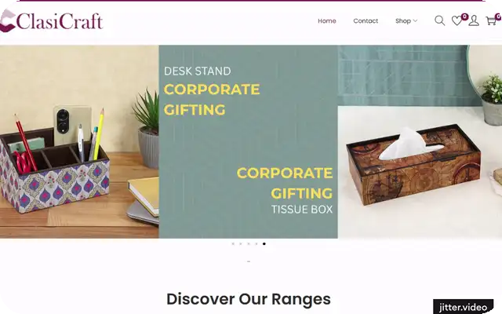</a>
  <a href="https://github.com/404reese">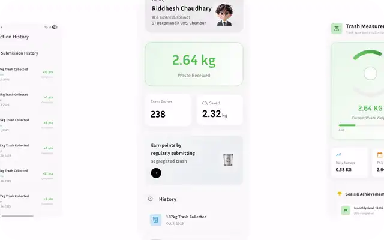</a>
  <a href="https://clasicraft.in"></a>
  <a href="https://github.com/404reese"></a>
  <a href="https://timelith.vercel.app">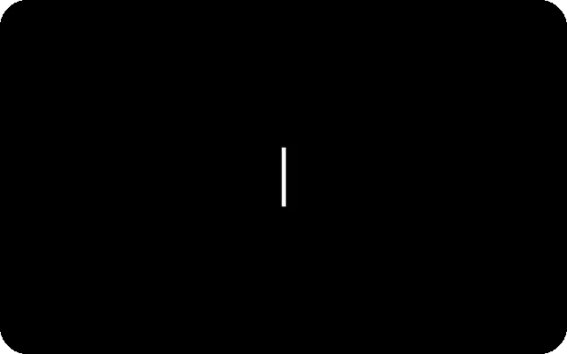</a>
  <a href="https://github.com/404reese">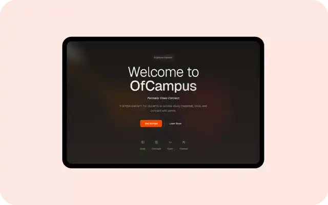</a>
  <a href="https://timelith.vercel.app"></a>
  <a href="https://github.com/404reese"></a>
  
  <a href="https://e-transcript.kjsit.org/">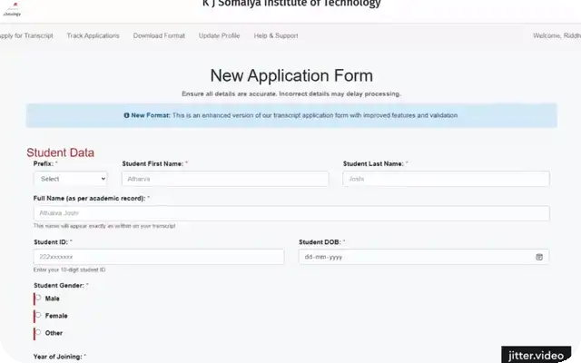</a>
  <a href="https://riddhesh.me/stemapp"></a>
  <a href="https://e-transcript.kjsit.org/"></a>

